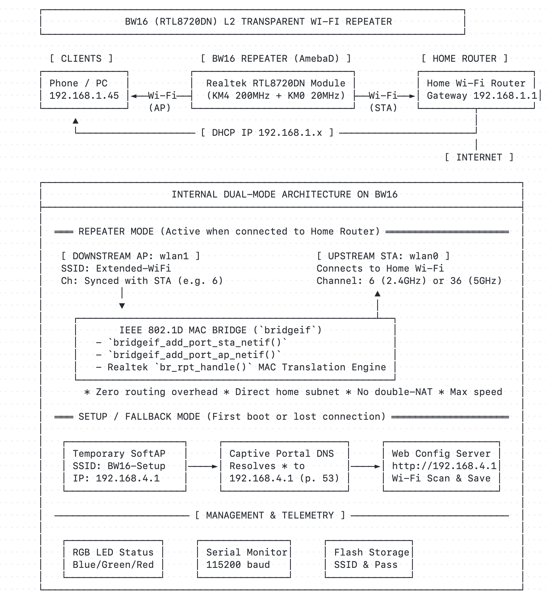

# BW16 Wi-Fi Repeater

<p align="center">
  
</p>

A Wi-Fi repeater for the Ai-Thinker BW16 (Realtek RTL8720DN), using Realtek's L2 bridge and MAC translation. Clients receive their network configuration from the upstream router through a DHCP relay.

> **Known issue: low throughput.** In one 2.4 GHz test, the repeater achieved about 8 Mbps download and 10 Mbps upload, versus 37/41 Mbps directly. Results depend on the environment. WLAN buffer exhaustion and dropped frames were observed; the full cause is still under investigation.

## Hardware

- Board: Ai-Thinker BW16 (RTL8720DN)
- CPU: Realtek AmebaD (ARM Cortex-M4 @ 200 MHz, Cortex-M0 @ 20 MHz)
- Radio: Dual-band 2.4 GHz (802.11b/g/n) and 5 GHz (802.11a/n) 1T1R

## Quick start

1. Flash the firmware or use the prebuilt binary in `bin/bw16_repeater_firmware.bin`.
2. Power on the board.
3. Connect your computer or phone to the open Wi-Fi network named `BW16-Repeater`.
4. Open `http://192.168.4.1` in your browser.
5. Select your home network from the scan list, enter the Wi-Fi password, and click Connect & Amplify.
6. The repeater applies settings, restarts, connects to your router, and starts the extended network. Connect your devices to the new extended network name shown on the screen.

## How to return to setup

If the router is unavailable, connect to the repeater's network and open `http://192.168.4.1` to access its local interface.

### Automatic fallback
If the upstream connection fails, the repeater keeps its settings, retries in the background, and provides local DHCP for access to the device.

### Web interface
Open the device's web interface using its current IP address, then select Reset to Setup Portal.

### Serial console
Connect via serial monitor at 115200 baud and send the command `reset`.

## Status LED

The onboard RGB LED indicates the current state:

- Blinking red: setup mode active (`BW16-Repeater` at `192.168.4.1`).
- Blinking blue: connecting to upstream Wi-Fi.
- Solid green: repeater bridge active, client traffic forwarding.

## How it works

The firmware enables concurrent station and access point mode on the RTL8720DN radio. Once associated with the upstream router, the AmebaD kernel activates the IEEE 802.1D bridge (`bridgeif`) across `wlan0` (station) and `wlan1` (access point) and disables the internal DHCP server. A DHCP relay forwards client requests to the upstream router and returns its replies to clients.

Because the bridge operates at layer 2:
- Clients get their IP, default gateway, and DNS servers straight from your main router.
- Local network reachability and discovery depend on the router and its handling of broadcast and multicast traffic.

### Channel Selection & 5 GHz Bands
The RTL8720DN uses a single radio transceiver:
- The repeater AP operates on the **exact same radio channel and band** as the upstream router.
- **2.4 GHz (Channels 1–13):** Recommended for general repeating (highest wall penetration and 100% device compatibility).
- **5 GHz (Channels 36, 40, 44, 48):** Fully supported. If extending 5 GHz, configure your home router to use non-DFS channels **36–48**. Channels 52–144 (DFS / radar) and channels > 48 (UNII-3) have SoftAP hardware/driver limits.

## Documentation

- [System Architecture](docs/architecture.md): Hardware, dual-core partitioning, and subsystem design.
- [Layer 2 Bridge vs NAT](docs/bridge-vs-nat.md): Why transparent bridging is used instead of double NAT.
- [Building on macOS](docs/build-macos.md): Setting up Arduino CLI and compiling the AmebaD core.
- [Flashing Guide](docs/flash.md): Wiring, bootloader mode, and UART flashing instructions.
- [Hardware Limitations](docs/limitations.md): Radio constraints, channel lock, and power requirements.
- [Test Plan](docs/test-plan.md): Verification matrix and end-to-end testing procedures.

## Building from source

### Prerequisites

Install Arduino CLI and the AmebaD core:

```bash
arduino-cli config init
arduino-cli config set board_manager.additional_urls https://raw.githubusercontent.com/Ameba-AIoT/ameba-arduino-d/master/Arduino_package/package_realtek_amebad_index.json
arduino-cli core update-index
arduino-cli core install realtek:AmebaD@3.1.9
```

The build requires AmebaD Core 3.1.9. `scripts/build.sh` enables `CONFIG_EXAMPLE_WLAN_REPEATER`, rebuilds the bridge-related LwIP objects with a consistent ABI, and verifies the three-interface `xnetif` symbol. Editing the header alone does not rebuild the precompiled core library.

The option is located in:
`~/.arduino15/packages/realtek/hardware/AmebaD/3.1.9/system/project/realtek_amebaD_va0_example/inc/inc_hp/platform_opts.h`

### Build

Run the build script:

```bash
bash scripts/build.sh
```

Compiled binaries are placed in `build/` and `bin/`.

## Flashing

To flash the board over USB:

1. Connect the BW16 to your computer with a USB-UART adapter.
2. Put the board into download mode:
   - Hold the BURN button.
   - Press and release the RST button.
   - Release the BURN button.
3. Run the flasher:

```bash
python3 do_flash.py
```

The script detects the serial port, uploads the image, and resets the board. Its default upload rate is 921600 baud on macOS and 1.5 Mbaud elsewhere.

## License

MIT
